# Fantasy Map Simulator: Races

Игра-наблюдатель на Godot 4.7: процедурный фэнтезийный мир, где государства
разных рас растут, торгуют, воюют и распадаются, а игрок наблюдает и вмешивается.
Главная особенность — расы реально влияют на симуляцию (биомы, рост, война, дипломатия).

## О проекте

Песочница-наблюдатель о фэнтезийном мире: карта генерируется по seed, расы
основывают государства, торгуют, воюют, молятся, открывают технологии, а
игрок наблюдает, вмешивается как Бог или играет за одного героя. Всё —
на GDScript, без плагинов и внешних ассетов (иконки — SVG, звук — синтез).

Темы: `godot`, `godot4`, `gdscript`, `procedural-generation`, `simulation`,
`fantasy-map`, `strategy`, `sandbox`.

| Политическая карта | Расы | Религии |
|---|---|---|
| 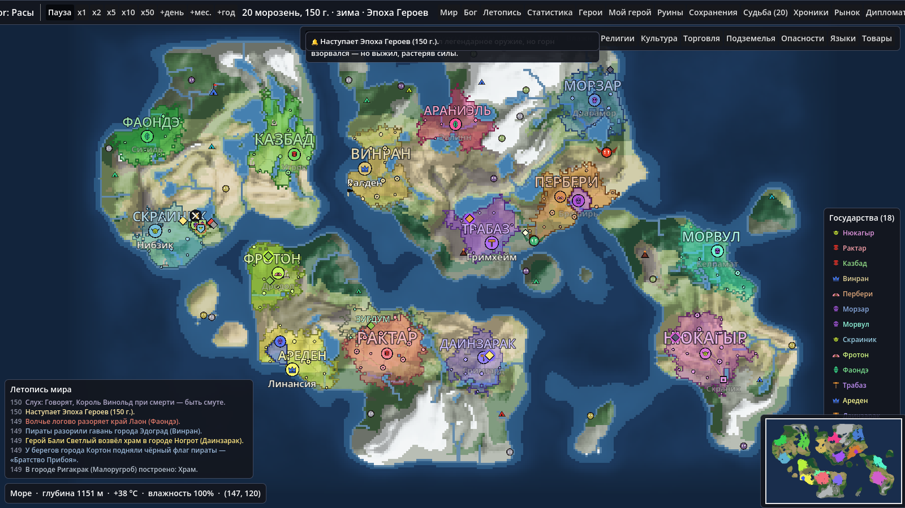 | 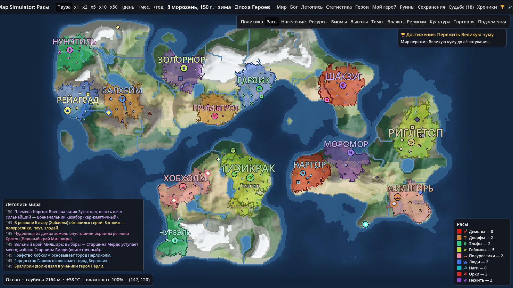 | 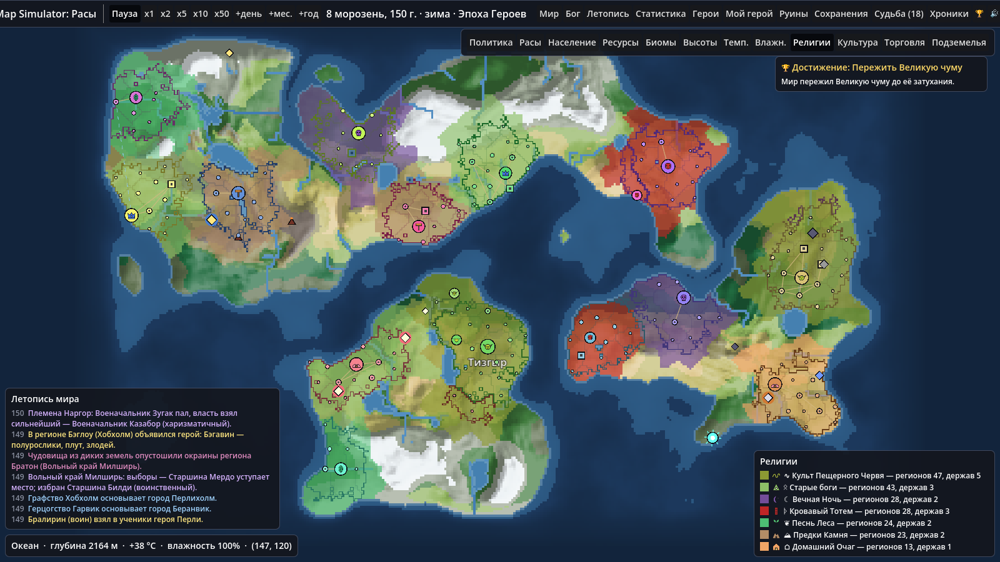 |
| **Торговля** | **Карточка государства** | **Мой герой** |
| 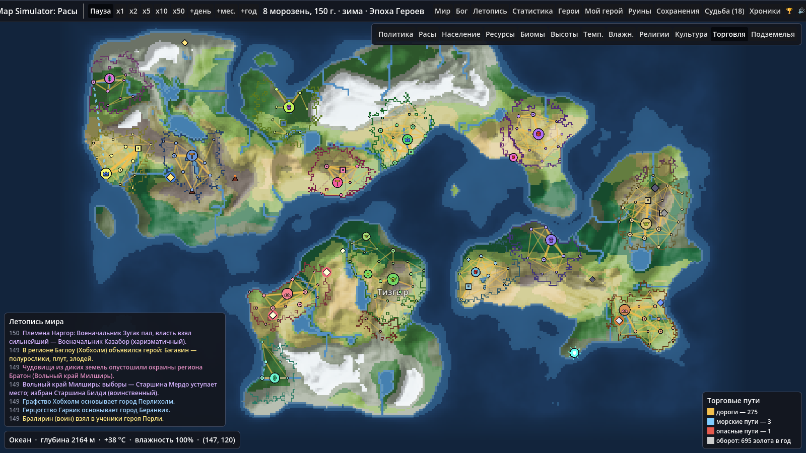 | 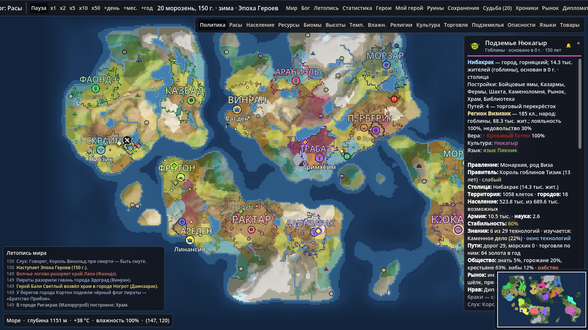 | 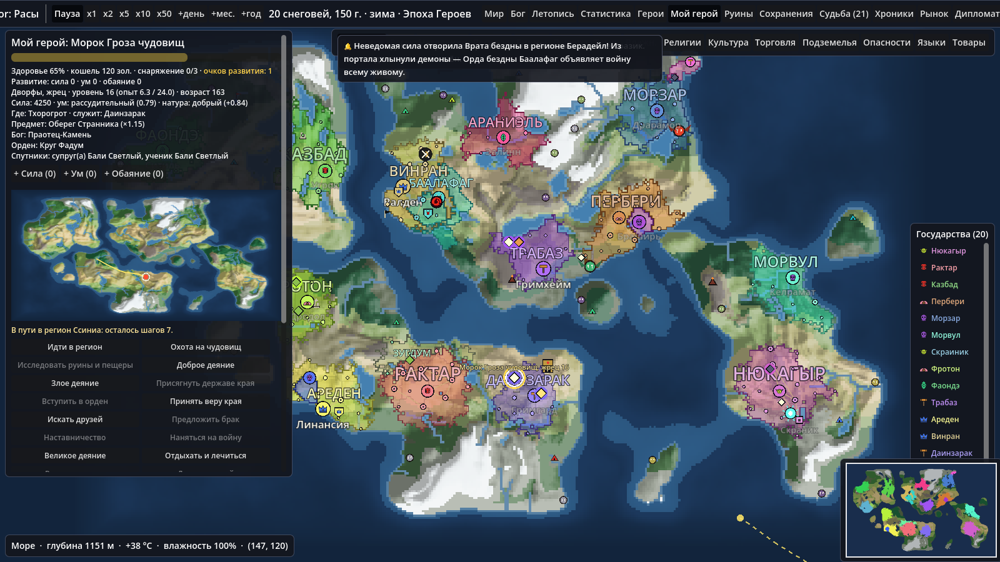 |
| **Армия на марше** | **Хроники войны** | **Подземный мир** |
| 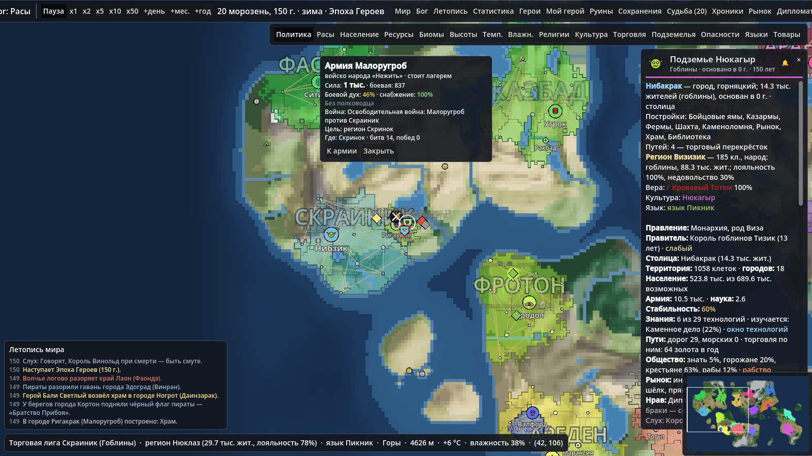 | 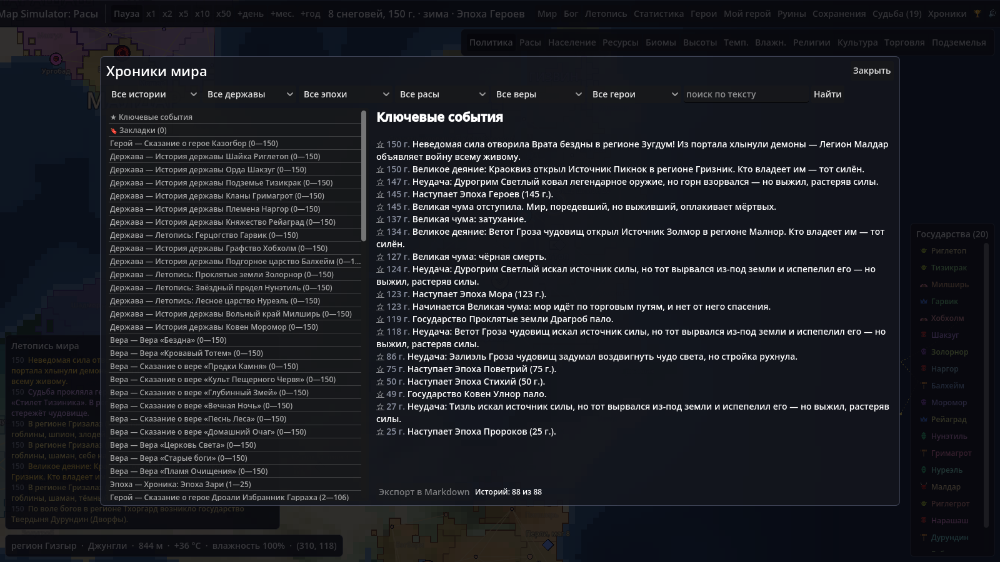 | 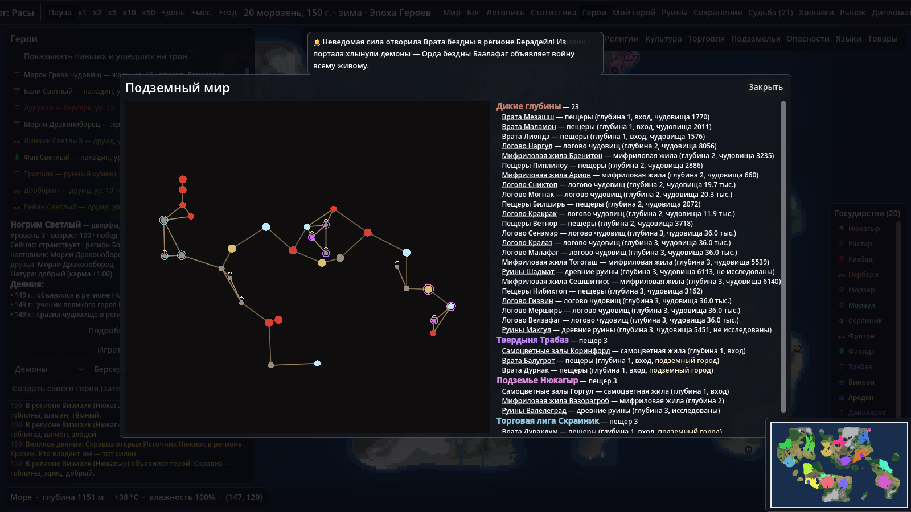 |
| **Опасности** | **Языки** | **Товары** |
| 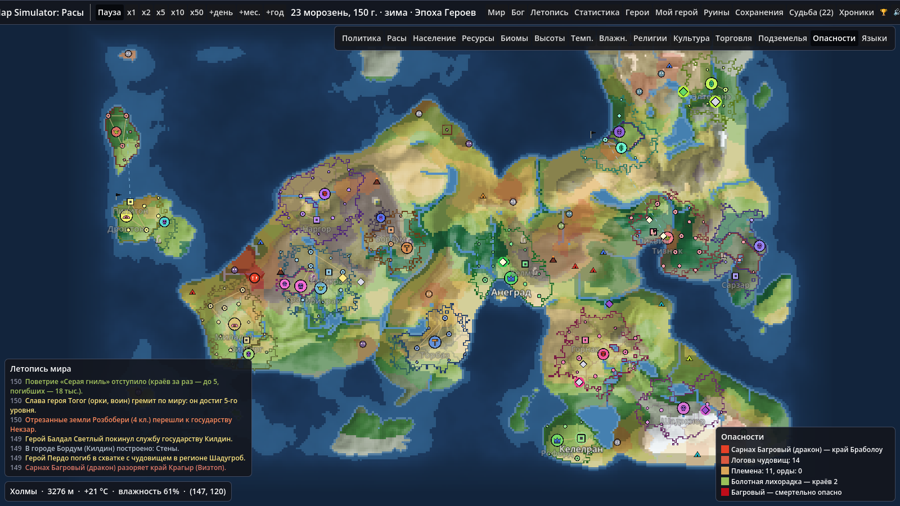 | 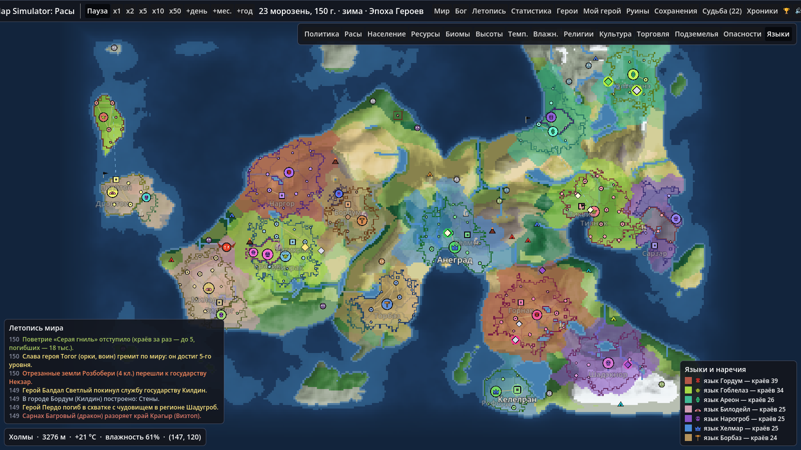 | 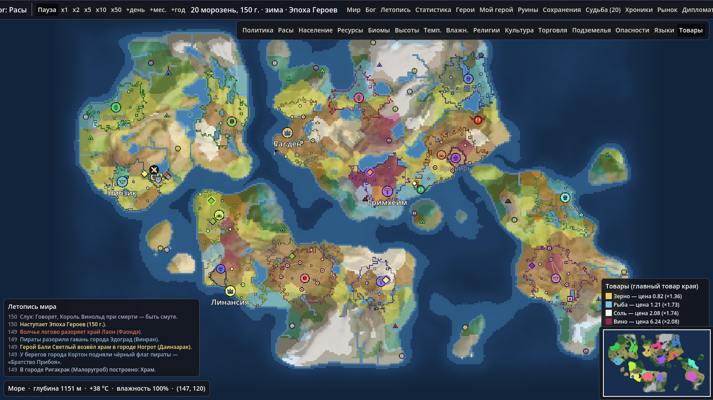 |
| **Рынок** | | |
| 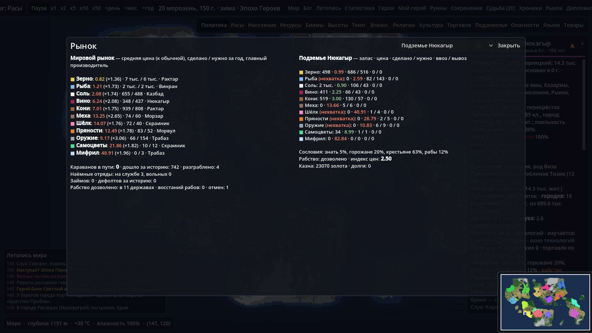 | | |

Скриншоты обновляются скриптом `tests/screenshot_tool.gd` (см. «Тесты»).
Лицензия — `LICENSE` (пока MIT-заглушка, выбор за владельцем), история
изменений — `CHANGELOG.md`.

## Запуск

Откройте папку в Godot **4.7+** и нажмите F5 — главная сцена `scenes/main.tscn`.
Внешних плагинов нет.

### Управление

| Действие | Ввод |
|---|---|
| Зум к курсору | колесо мыши, `Q` / `E`, жест щипка (плавно, к курсору) |
| Перемещение | перетаскивание ЛКМ / СКМ / ПКМ (с инерцией), `WASD` / стрелки (`Shift` — быстрее) |
| Показать всю карту | `F` (плавный перелёт) |
| Плавность | кнопка 🔊 — раздел «Плавность»: пресеты «Мгновенно / Мягко / Максимально плавно», камера, анимации интерфейса, границ и значков, эффекты событий |
| Режимы карты | кнопки справа вверху или клавиши `1`–`9`, `0`, `-`, `=`, `[` (опасности), `]` (языки), `\` (товары) — подсказка на кнопке |
| Пауза / продолжить | `Пробел`; скорость — `x1` (10 дней/с) `x2` `x5` `x10` `x50`; шаг — «+день» / «+мес.» / «+год» |
| Судьба | кнопка «Судьба (N)» — суд над павшими героями (на время суда игра на паузе) |
| Выбрать государство | клик по территории (в карточке — ещё регион и город под курсором), строка легенды, ссылка в летописи; `Esc` — снять выбор |
| Панели | «Мир» (генерация), «Бог», «Летопись», «Статистика», «Герои», «Мой герой», «Руины», «Сохранения» — вверху справа; «Лента» — последние события |
| Окна | «Хроники» (связные истории, экспорт в Markdown), «Рынок» (цены и товары мира и государства, сословия, долги, наёмники), «Дипломатия» (журнал сделок, нравы держав, слухи и «показать правду»), 🏆 — достижения, 🔊 — звук и музыка |
| Сыграй за героя | «Герои» → «Играть за героя» (или «Создать своего героя») → команды в «Мой герой»; «Идти в регион» — клик по карте; в окне выбора — клавиши `1`–`4` |
| Окно героя | клик по значку героя на карте, двойной клик в списке «Героев» или «Подробнее о герое…»; «Следить» — камера за героем (`Esc` — перестать) |
| Сохранить / загрузить | панель «Сохранения»; `F5` — быстрое сохранение, `F9` — быстрая загрузка |
| Меню ☰ | справочник, история мира и ветви (вернуться в прошлое), уведомления, экспорт карты (PNG, пергамент, SVG-легенда), миникарта, обучение, язык интерфейса (русский / English) |
| Миникарта | в правом нижнем углу; клик — перелёт камеры; `M` — скрыть / показать |
| Уведомления | 🔔 в карточке государства и «🔔 Уведомлять» в окне героя — следить; важное всплывает сверху |
| Инструмент Бога | выбрать в панели Бога и кликнуть по карте; ПКМ или `Esc` — отмена |
| Армия | клик по значку армии или флота — карточка (сила, дух, снабжение, полководец, цель); «К армии» — перелёт камеры |
| Дикий край | клик по значку логова (клык; великое чудовище — с крыльями) или племени (шатёр; орда — со стягом), каравана (повозка / парус) или отряда наёмников (щит) — карточка; «К месту» — перелёт |

Seed может быть числом или любым словом («Арда», «Средиземье»…).

## План разработки

| Этап | Содержание | Статус |
|---|---|---|
| 1 | Каркас проекта, генерация карты (высоты, климат, реки, озёра, биомы), камера, панель генерации | ✅ готово |
| 2 | Расы как данные (`.tres`), генератор имён по слогам, размещение стартовых государств, отрисовка границ (шейдер) | ✅ готово |
| 3 | Тики симуляции: рост населения, экспансия, города, ресурсы и месторождения | ✅ готово |
| 4 | Регионы; разные города; войны, осады, мир; дипломатия (союзы, торговля, вассалитет); восстания, гражданские войны, распад; колонии; случайные события | ✅ готово |
| 5 | Календарь по месяцам; фронт и десанты без анклавов; политика (формы правления, характер правителей, династии, кризисы, браки, коалиции, претензии); герои; UI: режимы «население» и «ресурсы», летопись с фильтрами, статистика с графиками, панель Бога, герои, карточка региона и города | ✅ готово |
| 6 | Сохранение/загрузка (JSON), баланс, оптимизация; отношения героев (дружба, отряды, наставники, браки, месть, помощь на войне) | ✅ готово |
| 7 | Религии и ереси; технологии и культура | ✅ готово |
| 8 | Шпионаж и тайные общества, международные организации, наследие империй | ✅ готово |
| 9 | Дороги и торговля, климат, подземный слой, руины, мировые кризисы и эпохи | ✅ готово |
| 10 | Родословные героев, артефакты, ордена, боги; режим «Сыграй за героя»; хроники; достижения; процедурный звук | ✅ готово |
| 11 | «Живой мир» и плавность: G — инфраструктура и рефакторинг; A — плавность; B — армии и флоты; C — дикие земли; D — экономика и общество; E — дипломатия и ИИ; H — герой в новом мире; F — удобство | ✅ G, A, B, C, D, E, H, F |

## Архитектура

```
scenes/            главная сцена
scripts/
  autoload/        EventBus (сигналы), WorldState (текущий мир, фоновое создание),
                   Achievements (достижения), AudioManager (процедурный звук)
  core/            MinHeap (очередь с приоритетом), SaveSystem (← SaveSections ← SaveUtil), SmoothSettings,
                   AchievementTracker, Synth (синтез звука)
  data/            BiomeDef/BiomeDB, RaceDef/RaceDB, TraitDef, ReligionDef/ReligionDB, TechDef/TechDB, OrgDef/SpyOpDef/OrgDB, CrisisDef/CrisisDB,
                   ArtifactDef/GodDef/HeroEventDef/LoreDB, ChronicleTemplateDef, AchievementDef — описания данных
                   и реестры; Registry — общий загрузчик «папка → список + поиск по id»
  map/             MapSettings, WorldMap (данные карты), MapGenerator, Biome (индексы)
  sim/             World (модель мира: World ← WorldTerritory ← WorldGeo ← WorldData), Nation, City, Region + RegionGenerator, War, Diplomacy,
                   Hero, Religion, Culture, Society, Organization, Legacy, Road, Cave, Ruin, Artifact, HeroOrder, Chronicler (летописец), WorldSeeder (стартовые государства), NameGenerator, GodTools,
                   Simulation (движок: месяц = тик)
  sim/systems/     EconomySystem, PopulationSystem, ExpansionSystem, CitySystem, RulerSystem,
                   UnrestSystem, EventSystem, DiplomacySystem, WarSystem, EnclaveSystem, HeroSystem,
                   ReligionSystem, TechSystem, CultureSystem, SpySystem, SocietySystem, OrgSystem,
                   LegacySystem, RoadSystem, ClimateSystem, UndergroundSystem, RuinSystem,
                   CrisisSystem, EraSystem, ArtifactSystem, LineageSystem, OrderSystem, GodSystem,
                   PlayerSystem (игра за героя)
  render/          MapRenderer + political_map.gdshader (границы), MapOverlay (города, подписи),
                   MapPainter (данные → Image), MapMode
  camera/          MapCamera
ui/                HUD, карточка государства, летопись, статистика (LineChart), герои, окно героя,
                   окно технологий, сохранения, панель Бога, «Мой герой» и окно выбора, «Хроники»,
                   достижения, звук, тема
data/biomes/       по одному .tres на биом — цвет, плодородие, проходимость, пригодность
data/races/        по одному .tres на расу (см. ниже)
data/traits/       особенности рас (название + описание)
data/deposits/     месторождения (железо, золото, мифрил, мрамор, самоцветы, корабельный лес)
data/buildings/    постройки городов: стоимость, условия, эффекты
data/events/       случайные события (чума, голод, саранча, чудовища, дракон, герои, ярмарка, переселение,
                   восстание мертвецов, падение звезды, затмение, катастрофы…)
data/governments/  формы правления: наследование, выборы, власть сильнейшего, бессмертный владыка
data/ruler_traits/ черты характера правителей (воинственный, мудрый, алчный, безумный…)
data/hero_classes/ классы героев: веса по расам, карма, оружие
data/religions/    стартовые религии: символ, иконка, склонности рас, догматы и их эффекты, характер веры
assets/icons/religions/ иконки религий (SVG)
data/techs/        технологии: ветка, стоимость, требования, эффекты, склонности рас
data/spy_ops/      тайные операции: цена, шанс успеха, разоблачение, скандал
data/orgs/         международные организации: основа союза, правила, взносы, бонусы
data/crises/       мировые кризисы: стадии, эффекты, урожай, мор, шансы событий, особое поведение
data/artifacts/    виды артефактов: имена, сила, ум, карма, эффекты для сокровищницы
data/gods/         боги пантеона: сфера, натура, веры, дар державе, оружие проклятия
data/hero_events/  события пути героя игрока с вариантами выбора
data/chronicle_templates/ шаблоны летописца (части текста, варианты, синонимы)
data/achievements/ достижения: условие, цель, скрытое
assets/icons/      иконки рас (SVG)
tests/             headless-тесты и скрипт скриншотов
```

Принципы:

* **Логика отдельно от отображения.** `WorldMap` — плоские `Packed*Array`
  (индекс = `y * width + x`), `MapGenerator` не знает о сцене и работает в фоновом
  потоке (`WorkerThreadPool`). Рендер и UI только читают данные и слушают `EventBus`.
* **Данные отдельно от кода.** Свойства биомов — в `data/biomes/*.tres`; расы и
  события на следующих этапах будут устроены так же.

### Почему рендер через Image/Texture2D, а не TileMap

Карта — это 60–370 тыс. клеток, и в политических режимах их цвета меняются
каждый «год». `TileMapLayer` на таком объёме дорог в памяти и при массовых
изменениях ячеек. Здесь вся карта — **одна текстура** (1 тексель = 1 клетка) на
`Sprite2D` с фильтром «nearest + mipmaps»: один draw call, обновление — один
`ImageTexture.update()`. Цвета пишутся пачкой как 32-битные числа в
`PackedInt32Array`, без `set_pixel`. На этапе 2 поверх ляжет шейдер, читающий
текстуру владельцев клеток, — заливка и контуры границ будут считаться на GPU.

### Расы

Стартовый набор: люди, эльфы, дворфы, орки, гоблины, нежить, полурослики.
Ещё две расы не появляются на старте (`spawn_at_start = false`): **наги**
(поднимаются с островом из пучины) и **демоны** (приходят через Врата бездны).
Каждая раса — файл `data/races/<id>.tres` (скрипт `RaceDef`), где задаются:

* **биомы** — `biome_affinity` (id биома → 0..1), `default_affinity`, `foreign_biome_penalty`
  (во сколько раз дороже расширяться в чужие биомы), `coast_affinity`;
* **модификаторы** — рост, военная сила, торговля, наука, скорость экспансии,
  продолжительность жизни, потребность в еде;
* **дипломатия** — `relations` (id расы → −1..+1), отношение к своей расе, агрессивность;
* **особенности** — список id из `data/traits/` (рудокопы, миролюбие, «не нуждаются в еде»…);
* **язык** — слоги для имён, окончания мест и личных имён, формы правления
  («Королевство {name}|Король»), гласные-связки;
* цвет и иконка.

Уже сейчас раса определяет, где появится государство (родные биомы, реки,
побережье), как оно расширяется (стоимость клеток по биомам), сколько
жителей прокормит земля (нежить не зависит от плодородия, полурослики-земледельцы
получают бонус) и как звучат имена. Остальные параметры включатся
в симуляцию на этапах 3–4.

**Добавить расу:** скопируйте любой `.tres` в `data/races/`, поменяйте `id`,
параметры и иконку — она автоматически появится в панели генерации и в мире.

### Симуляция

Один тик = один год. `Simulation.step()` по очереди обходит государства
(с каждым годом начиная с другого) и вызывает системы:

1. **EconomySystem** — добыча (биом + месторождения + постройки, × наука),
   налоги и торговля, содержание армии и построек, урожай с погодой и голод,
   рост науки, размер армии, стабильность (чужие народы с учётом расовых
   отношений, слишком большая территория, голод и долги её снижают; храмы
   и долголетие — повышают).
2. **PopulationSystem** — логистический рост каждого народа государства
   к ёмкости его земли (`RaceDef.growth`; голод уменьшает население).
3. **ExpansionSystem** — «очки экспансии» растут с периметром, давлением
   населения и стабильностью и тратятся на соседние ничьи клетки; цена
   клетки — `RaceDef.expansion_cost()` по биому.
4. **CitySystem** — рост городов (доля горожан расы), основание новых
   (по `cells_per_city` расы, с минимальной дистанцией), строительство
   построек из `data/buildings/`, в том числе расовых: глубинные копи
   и крепости дворфов, священные рощи эльфов, некрополи нежити, бойцовые
   ямы орков и гоблинов, норы полуросликов.
5. **RulerSystem** — смена правителей по продолжительности жизни расы
   (эльфы правят веками, нежить — пока не падёт).

Клетка помнит, какой народ в ней живёт (`World.cell_race`): при смене
владельца жители переходят вместе с землёй, поэтому многорасовые государства
появляются естественно (на этапе 4 — через завоевания).

Симуляция идёт в главном потоке с бюджетом 20 мс на кадр. Тик не зависит от
размера карты линейно: системы трогают только свои государства, границы и
города; редкие пересчёты разнесены по годам со сдвигом по id (вера — раз в 3
года, культура и недовольство — в 5, дороги, разведка, исследования и рост
городов — в 2, подземелье — в 3), обходы клеток заменены счётчиками и графами.
Средний месяц со всеми системами этапов 7–9: ~0,9 мс на средней карте
(20 государств), ~2,4 мс на огромной (40) — `tests/profile_systems.gd`. Рендер обновляет текстуру владельцев не чаще раза за кадр,
подписи — не чаще ~7 раз в секунду.

### Регионы

При создании мира суша нарезается на регионы (~90 клеток на средней карте;
`RegionGenerator`): семена разносятся с минимальным расстоянием, а затем
растут «Дейкстрой» с целыми стоимостями (корзинная очередь), где горы, холмы,
болота и пересечение рек дороги — поэтому границы регионов ложатся по хребтам
и рекам. Регион получает имя на языке народа, который заселил его первым.

Клетками по-прежнему владеют государства, а регион — единица управления:
у него есть народ, лояльность владельцу и недовольство. На карте внутренние
границы регионов и их названия проявляются при приближении.

### Города

Города различаются по уровню — деревня, городок, город, крупный город,
великий город — и по специализации (порт, крепость, горняцкий, торговый,
город учёных, святыня, ремесленный, сельский). Горожане распределяются по
«весу» города: место × удача (логнормальная, у каждого города своя) ×
постройки × возраст × столица, в степени 1.4 — получается живое
неравномерное распределение: одна столица, пара крупных городов и много
городков и деревень. Значки и подписи на карте зависят от уровня.

### Войны, дипломатия, восстания (этап 4)

* **DiplomacySystem** — торговые договоры (доход обоим), союзы (вступают
  в войны друг друга), вассалитет (дань 15% прибыли; слабые просятся под
  защиту, окрепшие вассалы восстают, давние вассалы своей расы мирно
  присоединяются). Мнение государств = расовые отношения + договоры + обиды
  (память о войнах; долгоживущие помнят дольше) + трение на границе.
* **Объявление войны** складывается из причин — земельный голод, богатства
  соседа, расовая вражда, месть — × агрессивность расы × соотношение сил.
  Эльфы и полурослики почти не нападают первыми, «незаметных» полуросликов
  реже выбирают целью, орки воинственны.
* **WarSystem** — счёт войны и мир; сражения с этапа 11.B ведут армии на
  карте (см. «Армии, флоты и полководцы»). Потери в битвах
  (трусливые гоблины бегут, нежить поднимает павших), осада пограничного
  региона; стены и дворфийские крепости замедляют осаду, эльфы сильнее в
  лесах. Взятый регион переходит победителю вместе с жителями — так
  возникают многорасовые государства. Мир — решительной победой (вассалитет
  или контрибуция), по очкам или белым миром; затем перемирие и обида.
* **UnrestSystem** — лояльность регионов падает из-за чужого народа
  (сильнее при расовой вражде), удалённости от столицы, недавнего завоевания
  и слабой власти. Переполненное недовольство — бунт: чужой народ отделяется
  (освободительная война), свой при слабой власти — гражданская война;
  безнадёжные бунты подавляют. Годы на дне стабильности — распад государства
  на части вокруг крупных городов.
* **Колонизация** — государствам, которым некуда расти, из портов за море.
* **EventSystem** — события из `data/events/`, собранные из «кубиков»
  эффектов (потери населения/армии/золота, голод, разрушение городов и
  построек, опустошение земель, временные множители армии/роста/науки,
  распространение на соседей). Нежить не болеет чумой и не голодает.

### Календарь

Базовый тик — день (`Simulation.step_day`): 30 дней в месяце, 12 месяцев,
дата — «5 морозень, 120 г.». Годовые дела государства (экономика, рост,
экспансия, города, правители, восстания, события, дипломатия) выполняются
в «его» день года — он однозначно задан id (`id = месяц + 12·день + 360·k`),
поэтому расписание не требует перебора. Войны с армиями ходят раз в месяц в свой день (этап 11.B), герои, племена, логова и поветрия — тоже раз в месяц, каждый в свой день; герои действуют раз в месяц — каждый в свой день. На x1 проходит
10 дней в секунду (год ≈ 36 с), на x50 — 500 дней (≈ 1,4 года в секунду).

### Фронт, десанты и анклавы

Осаждать можно только регион на линии фронта — где клетки проигравшего
прямо граничат с клетками победителя. Если общей сухопутной границы нет,
а у победителя есть порт, — десант на побережье (медленнее). Взятый регион
переходит «волной» от фронта (или от берега): победитель получает только
связные с фронтом клетки. `EnclaveSystem` раз в 25 лет и после каждого
захвата отдаёт отрезанные клочки, окружённые одним соседом, этому соседу;
заморские колонии и прибрежные владения остаются.

### Политика

* **Формы правления** (`data/governments`, третье поле в `state_forms` расы):
  монархия и империя (наследник рода, династические браки), республика,
  олигархия и совет кланов (выборы раз в N лет), племенной союз (власть
  сильнейшего, частые смуты), теократия, некрократия (бессмертный владыка,
  гибнет вместе со столицей). Влияют на агрессивность, торговлю, науку,
  армию и стабильность.
* **Правители**: имя по языку расы, род, порядковый номер («Эдрик II»),
  черта характера (`data/ruler_traits`), меняющая решения государства.
* **Кризис престолонаследия** при слабой власти: претендент поднимает
  дальние регионы (гражданская война) или — по династическому браку —
  корону получает соседний двор (личная уния → вассалитет).
* **Претензии**: потерянные регионы государство помнит 80 лет — это повод
  для войн «за возвращение земель», и в войне такие регионы — первые цели.
* **Коалиции**: против гегемона (больше 22% занятой суши) соседи раз в
  несколько десятилетий объединяются в союз и могут сразу выступить войной.

### Герои

Приходят событием «Прибытие героя»: раса — по народу региона, класс —
по расе (`data/hero_classes`: воин, маг, следопыт, паладин, некромант,
берсерк, плут, жрец, друид, рунный кузнец, шаман). Странствуют по регионам,
совершают подвиги (чудовища, драконы, клады, защита селений — регион
успокаивается), получают уровни и прозвища, встречают других героев и
бьются с ними (враждующие расы и слуги воюющих держав — чаще). Могут
присягнуть государству (охотнее — своему народу): тогда их сила добавляется
к военной мощи, они идут к осаждаемым регионам, бьются с героями врага и
могут пасть — или, прославившись, занять трон и основать династию.
Слабое государство герои покидают.

### Отношения героев

Встретившись в одном регионе, герои не только дерутся, но и разговаривают
(`HeroRelations`): похожая карма и дружественные расы сближают,
противоположная натура отталкивает. Из отношений вырастают дружба (друзья не
дерутся и мстят за гибель друга), отряды странников (вместе безопаснее против
чудовищ), наставничество (опытный учит младшего — тот быстро растёт; старый
мастер может воспитать ученика своего класса), браки, вербовка (слуга
государства зовёт друга на службу) и вражда (враги ищут поединка). Странники
приходят на помощь на войне: другу, доброму народу против демонов — или
нанимаются за золото. Погибают герои реже, чем прежде: проигравший поединок
чаще бежит, в бою гибнут редко, а опыт копится и в дороге — за 200 лет
появляются герои 15–20 уровня.

### Ум героев

У каждого героя есть ум (`intellect` класса в `data/hero_classes` плюс личный
разброс, с уровнями герои немного умнеют). Перед боем со стражем пустого
трона герой оценивает его силу: умный оценивает почти точно, требует
запас сил и ждёт, пока окрепнет (а увидев стража вблизи, может отступить);
глупец недооценивает врага и идёт на верную смерть. Умные реже гибнут в
схватках с чудовищами и уклоняются от поединков с явно сильнейшими.
Самые безрассудные — берсерки и воины, самые мудрые — маги и рунные кузнецы.

### Поступки и великие деяния героев

У героя есть **карма** (−1…+1): склонность класса (паладин светел, некромант
тёмен) плюс личный разброс; поступки её сдвигают, натура тянет назад.
**Добрые дела**: битвы с чудовищами, защита селений (регион успокаивается),
исцеление (снимает чуму), помощь голодным, храмы в городах. **Злые**: грабёж
караванов, смута в регионе, сожжённые деревни, убийство правителя.

Прославленный герой (ур. 7+) иногда берётся за **великое деяние** — и чаще
проваливается (гибнет или теряет силы):
* поднять из пучины **остров нагов** — новая раса появляется в мире,
  герой правит их государством;
* открыть **источник силы** (не больше двух в мире): владелец региона
  сильнее в войне, умнее и стабильнее — источники становятся целью войн;
* (злодеи) отворить **Врата бездны** — появляется государство **демонов**,
  которое воюет со всеми, не заключает мир; портал каждый год подпитывает
  их армию, пока его не захватят;
* воздвигнуть **чудо света** в столице;
* выковать **легендарное оружие**.

### Судьба

Павшие герои попадают в **Чертоги Судьбы** (полноэкранная панель, игра на паузе):
* **второй шанс** — герой возвращается в мир (не больше двух раз);
* **оставить в покое**;
* **проклясть** — душа заточается в оружие, а в глухом месте карты появляется
  **пустой трон** со стражем. Честолюбивые (и тёмные) герои идут к нему;
  одолевший стража получает проклятое оружие (+60% к силе, карма темнеет),
  проигравший сам отправляется на суд.

Неосуждённые герои уходят на покой сами, когда очередь длиннее 60.

### Эффекты государства

`Nation.effects` — общий кэш эффектов от религии (а на следующих этапах —
технологий, организаций, кризисов). Каждый источник задаёт свой словарь через
`Nation.set_effects(источник, {ключ: значение})`: ключи `*_mult` перемножаются,
`stability` складывается. `Nation.policy()` (армия, торговля, наука,
агрессивность) и рост населения учитывают эти эффекты — существующие системы
видят новые механики без правок.

### Религии и ереси (этап 7.1)

Стартовые веры — `data/religions/*.tres` (`ReligionDef`): символ, иконка, цвет,
склонность рас (у людей три веры — Церковь Света, Старые боги, Пламя Очищения),
догматы с эффектами, миссионерство, терпимость, рвение, отношение к магии,
нежити и демонам. В мире по ним создаются объекты `Religion`; ереси и новые
веры появляются в ходе истории.

* У региона — доли вер (`Region.faith`), у государства — государственная вера
  и **единство веры** (доля единоверцев среди подданных).
* **ReligionSystem** (раз в 3 года в день государства, со сдвигом по id):
  государственная вера обращает подданных (быстрее при высоком
  миссионерстве и стабильности, жрецах и паладинах на службе, храмах; народ,
  склонный к вере, обращается охотнее); соседние регионы, торговые партнёры
  и миссионеры приносят свои веры; фанатики обращают покорённых силой.
  Угасшие веры отмечаются раз в 10 лет.
* **Эффекты**: догматы (наука, армия, торговля, рост, агрессивность,
  стабильность) и единство веры (стабильность, сильнее у нетерпимых вер).
  Единоверцы ближе друг к другу, иноверцы — дальше (в зависимости от
  терпимости). Иноверцы менее лояльны.
* **Войны**: «священная война» против иноверцев (рвение × нетерпимость,
  теократии — ×1.6), «крестовый поход» против нежити и демонов у вер,
  ненавидящих их; «восстание за веру» — иноверцы своего народа при слабой
  власти или фанатичной вере; «война раскола».
* **Ереси**: у давней (60+ лет) государственной веры при слабой власти и
  большой территории (теократии — чаще) рождается ответвление с изменёнными
  догматами в дальних регионах. У теократий и фанатичных вер ересь может
  обернуться **расколом** — отколовшиеся регионы провозглашают государство
  новой веры и воюют с прежним. Правитель, чьи подданные почти все сменили
  веру, принимает её сам. Живых вер в мире — не больше 24.
* Режим карты **«Религии»** (заливка по вере большинства региона, насыщенность
  — её доля), легенда с числом регионов и держав, вера в карточке государства и
  региона, фильтр «Вера» в летописи, инструменты Бога «Основать религию» и
  «Вызвать ересь».

### Технологии (этап 7.2)

`data/techs/*.tres` (`TechDef`) — 28 технологий в пяти ветках (военное дело,
хозяйство, общество, магия, мореходство): стоимость, требования, эффекты
(ключи `Nation.effects`: армия, наука, торговля, рост, добыча, осады,
мореходство, экспансия, культура; пропитание, оборона, стабильность) и
склонности рас (0 — расе недоступна: некромантия — только нежити, мифриловая
ковка и рунная магия — в первую очередь дворфам, лесное зодчество — эльфам).

* **TechSystem** (в день государства, сразу после экономики): прирост науки
  (`Nation.tech`) — это очки исследований, плюс учёные-герои на службе (маги,
  рунные кузнецы, жрецы). Направление выбирается по склонности расы, характеру
  правителя (воинственный — военное дело, мудрый — общество и магия, алчный —
  хозяйство…), форме правления, вере (враждебные магии веры её сторонятся),
  выходу к морю и дешевизне.
* **Распространение**: торговые партнёры, союзники и сюзерен (3% в год на
  партнёра), захват городов (35%). Чужое расовое искусство перенимается с
  вероятностью, равной склонности расы. Отколовшиеся наследуют знания (кроме
  недоступных их расе).
* **Эффекты**: множители через `Nation.effects`; осадное дело ускоряет осады,
  мореходство — десанты (верфи — ещё сильнее) и дальность колонизации,
  каменное дело и руны — оборону регионов, земледелие — ёмкость земли.
* **Постройки** получили поле `requires_tech`: библиотека — письменность,
  стены и крепость — каменное дело, глубинные копи — глубокие копи; новые
  постройки — университет, акведук, башня магов, мифриловая кузня (дворфы),
  верфь, банк.
* **Окно технологий** — ссылка «окно технологий» в карточке государства: ветки,
  состояние каждой технологии, прогресс, эффекты, открываемые постройки,
  требования и число знающих её государств. Инструмент Бога «Озарение».

### Культура (этап 7.2)

Каждое новое государство приносит свою **культуру** (`Culture`: имя, народ,
цвет, два обычая); регион получает культуру первых поселенцев. Отколовшиеся
земли сохраняют культуру прежней державы — наследники общей империи остаются
людьми одной культуры.

* **CultureSystem** (раз в 5 лет на государство): регион под властью другой
  культуры ассимилируется — быстрее при общей вере, родственном народе,
  сильной власти, высоком престиже владельца и у империй; медленнее у
  терпимых вер, кланов и племён. Перенявший культуру регион лоялен (своя
  культура +6% к лояльности, чужая −5%); не враждебные титульному народы
  перенимают и язык — их клетки переходят к народу государства
  (`World.convert_cell_race`, учёт ёмкости и жителей сохраняется). Это
  мирная альтернатива бунтам.
* **Престиж** — города по уровню, храмы, библиотеки, университеты, чудеса,
  число технологий и возраст державы. Он даёт **мягкую силу**: соседи
  относятся лучше, а слабые соседи с хорошим мнением могут сами перейти под
  покровительство (вассалитет).
* Режим карты **«Культура»** (своя культура владельца — ярко, ассимилируемая —
  бледнее), легенда с обычаями, культура и ход ассимиляции в карточке региона,
  фильтр «Знания» в летописи, инструмент Бога «Слияние культур».
* В «Статистике» — графики «Открытия по расам» и «Религии» (снимки раз в 5 лет).

### Шпионаж и тайные общества (этап 8)

* **Разведка** (`SpySystem`, в день государства): очки разведки копятся от
  дохода казны, тайных канцелярий (новая постройка, технология «Тайнопись»)
  и шпионов-героев на службе (новый класс «Шпион»), × эффект «разведка».
  Правитель затевает операцию против врага или недруга (тираны, безумцы и
  алчные — чаще, миролюбивые — реже): **диверсия** (сгоревшая постройка или
  склад), **подстрекательство** мятежа, **кража знаний**, **убийство
  правителя** (редкое и дорогое), **подкуп вассала** (отпадает и воюет за
  независимость), **дезинформация** (ссорит двух соседей). Операции описаны в
  `data/spy_ops`. Успех — от соотношения разведок и шпионов; раскрытый
  шпион портит отношения (скандал в летописи, пойманного могут казнить), а
  раскрытое покушение может стать «войной возмездия». Шпион-герой получает
  опыт и деяния за операции.
* **Тайные общества** (`SocietySystem`, раз в год для мира, не больше 6 разом):
  возникают в неспокойных державах — культы (тёмных вер или ересей),
  тайные братства (тянут золото из казны) и заговоры. Влияние растёт при
  слабой власти, расползается по регионам и разжигает недовольство;
  стабильные державы и теократии давят общества, тайная стража (разведка)
  раскрывает ячейки. Набрав силу в столице слабой державы, общество
  захватывает власть: культ делает свою веру государственной, заговорщики
  сажают на трон вожака.

### Международные организации (этап 8)

`data/orgs/*.tres` (`OrgDef`): торговая лига (договоры), орден магов (тайное
знание), военный пакт (соседи гегемона), священный союз (единоверцы), совет
рас (пока в мире есть демоны). `OrgSystem` раз в 5 лет собирает новые
организации, раз в 4 года принимает подходящих, каждый год исключает
нарушителей (война с членом, смена веры, ссора с основателем — с запретом
вернуться на 20 лет) и распускает опустевшие. Члены платят взносы, получают
бонусы (`Nation.effects`), лучше относятся друг к другу, **не воюют между
собой**, а при **общей обороне** вступают в войну за атакованного (кроме
внутренних смут). Коалиции против гегемона остались — пакт их дополняет.

### Наследие империй (этап 8)

Когда от великой державы (12+ регионов) откалываются земли, мир запоминает
её (`Legacy`) на 160 лет: осколки получают общее наследие, лучше относятся
друг к другу и могут **мирно воссоединиться** (соседи одного народа и веры,
хорошее мнение, заметно меньший — входит в больший). Сильнейший наследник
провозглашает себя **собирателем земель**: коренные земли империи в чужих
руках — повод для «войны за воссоединение».

В карточке государства — разведка и шпионы, организации, наследие и
собиратель, тайные общества в стране; в карточке региона — влияние обществ.
Фильтры летописи «Тайны» и «Союзы». Инструменты Бога: «Тайная операция»
(заказчик — выбранное государство), «Тайное общество», «Созвать
организацию» (вид — из списка), «Собиратель земель».

### Дороги и торговые пути (этап 9.1)

Сеть хранится как граф между городами (`World.roads`, `World.city_roads`), а не
по клеткам: отрисовка — линии между городами, расчёты — по рёбрам.

* **RoadSystem** (раз в 2 года в день государства, со сдвигом по id): казна
  прокладывает дорогу от города с наименьшим числом путей к ближайшему
  городу — своему или торгового партнёра (не дальше 34 клеток, у города —
  не больше 4 путей). Стоимость считается вдоль пути по рельефу (горы,
  болота, джунгли, снега дороже; реки — мосты, за камень); путь через воду
  невозможен. Порты (гавани) связываются **морскими путями** с мирными
  портами (до 70 клеток) — сверх лимита дорог.
* **Торговля**: доход дороги в год ∝ √(жителей двух городов) / (1 + длина/25) ×
  безопасность (× мореходство для морских путей), каждому концу — половина.
  **Перекрёстки** (3+ пути) растут быстрее. **Разбойники** (злые герои,
  грабящие караваны) снижают безопасность путей у городов региона,
  **пираты** — морских; безопасность восстанавливается. **Блокада**: путь
  между воюющими не приносит дохода.
* **Армии и власть**: дорога от города наступающих к осаждаемому городу
  ускоряет осаду (+25%); регион, чьи города связаны дорогами со столицей,
  вдвое меньше страдает от удалённости (лояльность).
* Отрисовка на `MapOverlay`: на общем плане — пути между крупными городами,
  при приближении — все; режим карты **«Торговля»** — толщина по обороту,
  опасные пути красноватые, морские — пунктиром; пути в карточке государства
  и города; фильтр «Торговля» в летописи; инструмент Бога «Проложить дорогу».

### Климат (этап 9.2)

**ClimateSystem** (раз в год для мира) делит карту на три пояса по широте —
север, умеренный, юг — и задаёт каждому урожайность года (`World.zone_harvest`;
экономика умножает на неё урожай по поясу столицы):

* **суровые зимы** (на севере чаще) — урожай ×0.8 на год; **засухи** (на юге
  чаще, при иссушении климата — ещё чаще) — ×0.7 на 2–4 года;
* **вулканы** — самые высокие вершины (одна на ~12 тыс. клеток суши, не ближе
  25 клеток друг к другу); извержение (0.3% в год) губит города рядом,
  уносит жителей, засыпает край пеплом на 15 лет и приносит **пепельную
  зиму** по всему миру (урожай ×0.8 на 2–5 лет, климат холодает);
* **наводнения** у рек (смывают запасы еды), **лесные пожары** (эльфам —
  тяжелее: горе всего народа), **обвалы** в копях у рудокопов-дворфов;
* **дрейф климата**: температура и влажность медленно блуждают (±0.12);
  раз в 20 лет при заметном сдвиге биомы пересчитываются в трёх случайных
  регионах — только в них (`World.change_land_biome` сохраняет учёт добычи и
  ёмкости земли), город на клетке защищает её от перемен.

Следы бедствий (пепел, затопления, гари, сушь) видны на карте и бледнеют со
временем; вулканы отмечены треугольниками (раскалённые — во время пепельной
зимы). В шапке — время года и пепельная зима; фильтр «Климат» в летописи;
инструменты Бога «Извержение» и «Засуха».

### Подземный мир (этап 9.3)

Второй слой — граф пещер (`World.caves`, `Cave`), а не вторая карта клеток:
узел — пещера под клеткой поверхности на глубине 1–3, рёбра — ходы.
Генерация детерминирована seed мира (собственный ГСЧ, не сдвигает ГСЧ мира):
входы (глубина 1, один на ~4000 клеток суши) — в горах и холмах; глубже —
пещеры, мифриловые и самоцветные жилы, логова чудовищ, древние руины; каждый
узел связан с двумя ближайшими соседней глубины, граф гарантированно связен.

* **UndergroundSystem** (раз в 3 года на государство): подземные народы
  (дворфы, гоблины, орки, нежить) занимают входы на своей земле и
  пробиваются глубже, сражаясь с чудовищами (часть армии); строят
  **подземные города** (+2% пропитания каждый, `Nation.effects`), добывают
  жилы (мифрил — металл и золото, самоцветы — золото), исследуют руины
  (золото, иногда знание). Воюющие бьются за пещеры (**подземные битвы**);
  пещера под осаждённым регионом — **подкоп** (осада ×1.3). Соседи по ходам
  без торговли недолюбливают друг друга, торговые партнёры — торгуют по
  туннелям. Логова плодят чудовищ; изредка (0.5% в год) — **нашествие из
  глубин**: полчища выходят через ближайший вход и бьют по его хозяину.
* Режим карты **«Подземелья»** (клавиша `=`): затемнённая поверхность, ходы
  (глубже — темнее), узлы по виду, кольцо — цвет хозяина, дуга — вход,
  квадрат — подземный город. **Окно подземного мира** (кнопка в легенде):
  мини-карта графа и список пещер по хозяевам (клик — к пещере). Пещеры — в
  карточке государства, фильтр «Подземье», инструмент Бога «Нашествие из глубин».

### Руины и археология (этап 9.4)

Руины (`Ruin`, `World.ruins`) остаются от **разрушенных городов** (крупных —
всегда, столица — богаче), от **павших государств** (храм их веры на месте
последней столицы) и от **павших прославленных героев** (гробница, ур. 8+).
У руин — богатство, сила стражей, иногда проклятие.

* **Герои** (раз в год, если руины в их краю) решаются на вылазку по своему
  уму (умный не полезет к стражу не по силам): находят золото, древнее
  оружие (в гробнице — оружие покойного героя), знание для своего
  государства, навлекают проклятие — или гибнут и уходят на суд Судьбы.
* **Государства** с письменностью раскапывают руины на своей земле (раз в
  5 лет): золото, иногда знание, но проклятие может обернуться мором.
* **Возрождение**: основывая город, государство охотно ставит его на руинах;
  в храме забытых богов может собраться культ. **Пустой трон** проклятого
  Судьбой героя встаёт в глухих руинах, если такие есть.
* На карте — обломки колонн (исчерпанные — бледнее, проклятые — в лиловом
  ореоле, у гробниц — надгробие); панель **«Руины»** со списком; руины в
  карточке региона; фильтр «Руины» в летописи; инструмент Бога «Древние руины».

### Мировые кризисы и эпохи (этап 9.5)

`data/crises/*.tres` (`CrisisDef`): Великая чума, ледниковый век, нашествие
из-за края мира, пробуждение титана, великая засуха, звёздный дождь, война
богов. **CrisisSystem** (раз в год): не чаще раза в 150 лет (0.5% в год)
начинается кризис — он идёт стадиями («Первые вести о море» → «Чёрная
смерть» → «Затухание»), на каждой — эффекты для всех государств
(`Nation.effects`, источник `crisis`), мировой урожай, ежегодная гибель
жителей, множители шансов событий `data/events`. Особое: ледник гонит климат
к холоду (биомы дрейфуют), Орда высаживается у края карты с огромной армией
и воюет со всеми, титан бредёт к крупнейшему городу и крушит города на пути
(его может сразить герой или измотать армия), звездопад рушит города в
руины, война богов — божьи кары и рвение вер. Против Орды и титана народы
собирают **Великий союз** (организация с общей обороной, распадается с концом
кризиса).

**Эпохи** (`EraSystem`): раз в 25 лет (и сразу при начале и конце кризиса) мир
получает имя эпохи — по главной теме летописи последних 50 лет («Эпоха
Мечей», «Эпоха Пророков», «Эпоха Знаний», «Эпоха Тайн», «Эпоха Смут»,
«Золотой век», «Эпоха Стихий», «Эпоха Глубин»…), по идущему кризису
(«Эпоха Мора», «Ледниковая эпоха», «Эпоха Орды») или по господству одной расы
над третью суши («Эпоха Железных королей» — `era_title` расы). Эпоха — в шапке,
смены — в летописи (фильтр «Кризисы и эпохи»), история эпох и кризисов —
в сохранении. Инструмент Бога «Мировой кризис».

### Артефакты, роды, ордена и боги (этап 10.1)

**Артефакты как предметы** — `data/artifacts/*.tres` (`ArtifactDef`: вид,
шаблоны имён, множитель силы, сдвиг кармы, прибавка к уму, эффекты для
державы, «знаменитый»). Конкретный предмет (`Artifact`, `World.artifacts`)
в каждый момент у героя, в сокровищнице державы или потерян в клетке; у него
своя история владения. `ArtifactSystem`: легендарное оружие великого деяния
и проклятое оружие пустого трона — частные виды предметов; в руинах герой
находит предмет по весам видов (или потерянный там раньше); при гибели
владельца предмет берёт победитель поединка, иначе супруг или дети, иначе
сокровищница его державы, иначе он лежит на месте гибели; герой на троне
отдаёт предмет в сокровищницу (эффекты — `Nation.effects`, источник
`relics`); при падении столицы реликвии забирает победитель; тёмные плуты и
шпионы крадут предметы; прославленные герои идут искать потерянные предметы.
Старые сохранения: строковое оружие героев превращается в предметы без ГСЧ.

**Родословные** (`LineageSystem`): у супругов-героев (шанс 10% в год, до 3
детей) рождается ребёнок; он растёт `World.hero_births` (18% жизни расы,
у бессмертных — 40 лет) и становится героем: класс родителя (60%), средние
карма и ум с разбросом, порой прозвище («… Младший»). Первые дети основывают
род (`World.lineages`, «Род Эдрика»), все потомки в нём. Родители и дети не
бьются друг с другом, дети наследуют предметы.

**Ордена и гильдии** (`OrderSystem`, `HeroOrder`): герой от 9 уровня может
основать орден по своему классу (рыцарский орден, гильдия магов, братство
теней, гильдия охотников, священный круг), не больше 8 живых. Странник того
же рода и близкой натуры вступает, встретив члена ордена рядом, соратника по
службе или придя в обитель. Члены не дерутся между собой и учатся быстрее;
ордена противоположной натуры враждуют; обитель даёт державе пользу (армия,
наука, разведка, еда, стабильность — источник `orders_hall`). Орден без
живых членов угасает.

**Боги** — `data/gods/*.tres` (`GodDef`: сфера, натура, веры, дар державе,
оружие проклятия). Боги веры молятся по стартовой вере-прародительнице, Гаррах
и Шут-Обманщик — общие. `GodSystem`: раз в 10 лет держава с единой верой
может получить милость бога на 10 лет (эффекты, источник `god`); герой выбирает
покровителя по вере края и натуре; бог избирает героя близкой натуры от
8 уровня («Избранник Аэлона») и дарует ему «Дар бога»; от героя противной
натуры бог отрекается, а порой испепеляет его. **Судьба**: избранник может
вернуться на раз больше, а проклятая душа заточается в оружие своего бога
(«Меч Рассвета Эдрика»).

Окно героя: предмет (сила, ум, карма), бог, орден, род, родители и дети (в
том числе растущие), история предмета. Карточка государства: сокровищница,
милость бога, обители орденов. Летопись: «Роды и ордена», «Боги и реликвии».
Инструменты Бога: «Даровать артефакт», «Милость бога», «Избранник бога»,
«Дитя героев», «Основать орден».

### Сыграй за героя (этап 10.2)

Панель **«Герои»**: «Играть за героя» берёт под управление выбранного
странника; «Создать своего героя» — раса, класс, имя, затем клик по
стартовому региону. Панель **«Мой герой»**: характеристики (уровень, сила, ум,
натура, предмет, бог, орден, спутники, репутация у держав, вер и орденов),
миникарта с путём, команды, журнал приключений, «Следить», «Вернуться к
наблюдению». Герой игрока на карте — в золотом кольце.

Логика — `PlayerSystem` (без интерфейса), состояние — в `World.player*` и в
сохранении. Команды: идти в регион (клик по карте; путь — поиск в ширину по
графу регионов, шаг — месяц, по дороге между городами — полмесяца, острова —
морской переход 3 месяца), охота на чудовищ, исследовать руины и пещеры,
доброе и злое деяние, присягнуть державе края, вступить в орден, принять веру
края, искать друзей, брак, наставничество, наёмничество, великое деяние (от 7
уровня), отдых. Недоступные команды серые, с причиной во всплывающей подсказке.

Автономное поведение `HeroSystem` для героя игрока отключено: без команд он
отдыхает и не гибнет без причины (старость, бой, кара богов — причины). Другие
герои встречают его по обычным правилам, но решение — за игроком: окно
выбора (2–4 варианта, клавиши 1–4) для встречи (заговорить, вызвать на
поединок, предложить союз; враждебный — принять бой, бежать по уму,
договориться) и для событий пути `data/hero_events/*.tres` (`HeroEventDef`:
текст, место — везде/на землях держав/в глуши, варианты с кармой, опытом,
репутацией, испытанием силой, риском гибели, предметом). Пока выбор не сделан,
мир стоит.

**Раны, кошель, развитие** (поля героя `wounds`, `gold`, `gear`, `guards`,
`strength`/`wit`/`charm`, `perk_points`; у автономных героев — нули).
Неудачная охота, проигранный бой или провал в событии — не мгновенная
смерть, а рана: сила падает до −50%, при ранах 100% герой гибнет. Раны
заживают сами (4% в месяц), при отдыхе — 12%, в городе — 25%; лекарь
вылечит сразу. Золото: награда державы за чудовищ, доля добычи в руинах,
задания, жалованье наёмника, события. За каждый новый уровень — очко
развития: сила (+8% к силе), ум (+0.04) или обаяние (скидки, переговоры,
спутники, репутация).

**Город** (`PlayerQuests`): «Рынок и лекарь» — кузнец (снаряжение 3 уровней,
+10% к силе каждый), лекарь, наёмная охрана (2 бойца на 3 года, +5% к силе
каждый), пожертвование храму. «Доска заданий» — до 3 заданий одновременно:
сразить чудовище, разогнать разбойников (бой при приходе), доставить послание
в город, исследовать руины, найти потерянный предмет; награда — золото, опыт
и расположение державы, у задания есть срок (просрочка — минус репутация).
Цели заданий видны золотыми ромбами на карте и миникарте, путь героя —
пунктиром; «К цели задания» (или «Идти» у задания) прокладывает путь.

**Отряд**: «Позвать в отряд» — герой рядом, который к вам расположен,
следует за вами; спутники добавляют половину своей силы в ваши бои.
**Поединок** игрока решает сила с учётом спутников; победив, вы выбираете —
добить или пощадить (пощада: +карма, соперник благодарен); проиграв —
ранены, а злодей может добить тяжелораненого.

**События** (`data/hero_events`, 18): кроме прежних — по местности (`terrain`):
лесная ведьма, обвал на перевале, кораблекрушение, мираж, болотные огни,
буран; в городе — турнир и карманник; гонец державы. Варианты могут стоить
денег (без денег такой вариант не предлагается), лечить, ранить и давать
задания (слухи в таверне, болотные огни, гонец).

Горячие клавиши при открытой панели «Мой герой»: `T` — идти (клик по карте),
`H` — охота, `R` — отдых, `G` — к цели задания.

Гибель героя открывает **Чертоги Судьбы**: продолжить за ребёнка,
ученика, спутника или супруга, выбрать другого героя или вернуться к
наблюдению; павший герой, как и все, попадает на суд Судьбы.

### Герой в живом мире (этап 11.H)

* **Задания — данными** (`data/quests`, `QuestDef`, `QuestDB`): прежние
  (чудовище, руины, послание, разбойники, пропажа) и новые — **логово**
  (бой с чудовищем по правилам `LairSystem`), **набег** (проучить племя или
  орду), **охрана каравана** (караван купцов выходит с героем; охраняемый
  грабят в ~7 раз реже), **торговый заказ** (привезти товар в город),
  **разведка** (до столицы соперника: держава-заказчик получает разведку,
  попавшийся — в плен), **поветрие** (остановить болезнь в краю),
  **посольство** (отношения теплеют, предлагается пакт), **клад по слухам**
  (правда или вымысел).
* **Товары героя** (`PlayerWorld`): на рынке города — купить дёшево (из
  запаса рынка державы), продать дорого; мешок — 20 единиц и по 10 на
  охранника; груз учитывается в рынке как «в пути».
* **Служба в войске**: присягнувший или наёмник вступает в войско своей
  державы поблизости — полководцем (если опытнее нынешнего) или офицером
  (дух войска); жалованье, опыт за битвы, раны и **плен** при поражении.
* **Плен**: только «Выкупиться» (40 золотых за уровень) или «Бежать»
  (ум помогает, неудача — раны и продление); по сроку отпускают.
* **Болезни, языки, слухи**: в краю поветрия можно заболеть (иммунитет
  потом); в краю чужой семьи языков цены выше и заданий меньше; слухи о
  кладах бывают ложными.
* **15 новых событий пути** — с условиями (поветрие, война, чужой язык,
  рабство, логово, караван, слухи) и **цепочками** (`next`/`delay` в
  варианте: продолжение через несколько месяцев — колодец и отшельник,
  беглец и его долг, спасённый караван, ростовщик и срок долга); новые ключи
  вариантов — `cargo`, `capture`, `swear`.
* **Панель «Мой герой»**: груз, служба, плен, язык края; команды «Вступить в
  войско», «Покинуть войско», «Выкупиться», «Бежать».

### Хроники и летописец (этап 10.3)

Кнопка **«Хроники»** в верхней панели открывает окно связных историй, которые
`Chronicler` собирает из данных мира: эпохи (вступление по тону эпохи —
мрачной, светлой или обычной, итоги, главные события), войны (повод, союзники,
битвы, потери, исход), герои (по расе и натуре, род, деяния, конец пути),
державы и династии (основание, правление, пик, главная война, события,
падение), веры (ереси, догматы, последователи), организации. Шаблоны —
`data/chronicle_templates/*.tres` (`ChronicleTemplateDef`): части текста
с вариантами (`intro`, `intro_dark`, `intro_<раса>`, `victory`…), подстановки
`{nation}`, синонимы `[then]`, `[chronicler]` (общий шаблон `common`).
Варианты выбирает собственный ГСЧ, засеянный id истории и seed мира: текст
стабилен и не влияет на симуляцию; список строится за миллисекунды, текст —
по запросу.

Фильтры: вид, держава, эпоха, раса, вера, герой; поиск по названию и тексту.
**Значимость**: у каждой записи летописи (по виду: великие деяния и кризисы —
5, эпохи — 4.5, падения держав — 4, … + охват держав) и у каждой истории (по
длительности, битвам, потерям, уровню героя); «Ключевые события» — записи
значимостью от 4. Закладки (☆/★) на события хранятся в сохранении мира.
«Экспорт в Markdown» пишет историю в `user://chronicles/` с датами, ссылками
на упомянутые державы, героев и веры и их списком. Имена в тексте окна —
ссылки (держава — показать на карте, герой — окно героя). Войны теперь
помнят, кто их начал и на кого напали (`War.first_attacker/first_defender`).

### Достижения (этап 10.4)

Только отметки об увиденном — без целей и условий победы. Данные —
`data/achievements/*.tres` (`AchievementDef`: id, название, описание, скрытое,
условие): «Мир без войн» (100 лет), «Нага правит континентом» (наги владеют
третью занятых земель), «Империя на четверть мира», «Герой двадцатого
уровня», «Врата бездны закрыты», «Пережить Великую чуму», «Вера трёх
народов», «Первая ересь», «Пять веков», «Сотня держав», «Избранник богов»,
«Братство клинков», «Огненная гора», «Закалённый мир», «Начало рода», «Сам
себе герой», «Летописец» и скрытые «Чертоги Судьбы», «Падение титана».

Профиль — `user://achievements.json`, вне сохранений мира. Автолоад
`Achievements` ставит миру наблюдателя (`World.observer`): записи летописи и
счётчики (`World.count`) уходят сигналом `EventBus.world_event`, логика мира
об EventBus не знает. `AchievementTracker` проверяет условия только по этим
событиям, по смене года (годовые условия: серия лет без войн, доли земель,
уровень героев, веры рас) и по событиям интерфейса (экспорт хроники) — без
опроса данных каждый тик. Прогресс (лучший за все миры) виден в окне 🏆;
скрытые достижения показаны как «???». Новые — всплывающие уведомления.

### Звук и музыка (этап 10.5)

Автолоад `AudioManager`, без внешних файлов: всё синтезирует `Synth` в PCM 16
бит (22 050 Гц) → `AudioStreamWAV`. **Музыка** — петли по 8 тактов: бас и
пэд по гармонии (I–IV–V–I–VI–IV–V–I), мелодия — блуждание по ступеням лада
(свой ГСЧ от имени темы: повторяемо, без копий известных мелодий), ударные в
напряжённых темах. Контексты (`Synth.CONTEXTS`): мирная, напряжённая (воюет
больше 40% держав), мрачная (чума у трети держав), героическая (игра за героя
или 25 с после великого деяния), особая тема мирового кризиса; в тёмных
контекстах мажорные лады заменяются минорными двойниками. **Лейтмотивы рас**
(`Synth.RACE_MOTIFS`): лад, тембр и тоника — люди мажор/треугольник, эльфы
лидийский/синус, дворфы дорийский/квадрат, орки фригийский/пила, гоблины
минорная пентатоника, нежить локрийский, демоны гармонический минор, наги
хиджаз, полурослики мажорная пентатоника; ведущая раса — раса героя игрока
или крупнейшей державы. Темы генерируются в фоне (`WorkerThreadPool`, ~1 с на
тему) и кешируются; смена — кроссфейд 3 с двумя плеерами.

**Звуки**: клик (режим карты, выбор державы), открытие окон, объявление
войны, осада, мир, чума и кризис, достижение, рождение героя, великое деяние,
Врата бездны, гибель героя (по записям летописи через `EventBus.world_event`,
не чаще раза в 0.4 с на звук). **Настройки** (кнопка 🔊): общая громкость,
музыка и эффекты с отключением — шины Master/Music/SFX, сохраняются в
`user://settings.cfg` (раздел `audio`). В headless-режиме (тесты) звук
выключается сам, вызовы безопасны.

### Интерфейс и панель Бога

* Режимы карты: политика, расы, **население** (плотность по клеткам,
  обновляется на ходу), **ресурсы** (месторождения, лес, камень, руда),
  биомы, высоты, температура, влажность.
* **Летопись** — фильтры по категориям, «только выбранное государство»,
  поиск; клик по записи — выбрать государство и показать столицу.
* **Статистика** — сводка мира и графики по эпохам (снимок раз в 5 лет):
  население рас, площадь и население крупнейших государств.
* **Герои** — список и карточка героя с деяниями; клик показывает героя на карте.
* **Карточка государства** — место клика (город: уровень, специализация,
  постройки; регион: народ, лояльность, недовольство, претензии), правление,
  правитель и род, экономика, народы, войны, союзы, вассалы, мнения соседей,
  история.
* **Бог**: создать государство выбранной расы, вызвать событие, объявить
  войну (агрессор — выбранное государство), поднять мятеж, призвать героя,
  поднять/опустить землю кистью (острова вырастают, земли уходят под воду
  вместе с городами; биомы, регионы и добыча пересчитываются), создать
  источник силы, открыть Врата бездны.
* На карте — источники силы, Врата бездны, пустые троны и чудеса света.

### Политическая карта

Владелец каждой клетки хранится в `World.owner` и параллельно в
`World.owner_texels` (RGBA8: id + 1 в каналах R,G; B — суша). Рендер загружает
эти байты в текстуру одним вызовом, а шейдер `political_map.gdshader` по ней
рисует заливку, контуры постоянной экранной толщины (при сильном отдалении —
целыми клетками) и выделение выбранного государства. Цвет берётся из
палитры-текстуры: в политическом режиме — цвет государства (у вассалов —
с оттенком сюзерена), в расовом — цвет расы. Вторая текстура — регионы
клеток — даёт тонкие внутренние границы регионов при приближении, а в режимах
«по регионам» (религии, культура) шейдер заливает регион цветом из палитры
регионов (`region_palette_tex`, альфа — уверенность): смена картины стоит
загрузки ~350 цветов, без прохода по клеткам.

### Плавность (этап 11.A)

Всё, что меняется, меняется постепенно, а камера, интерфейс и звук реагируют
мягко. Плавность касается только **отображения**: она не меняет мир и не
трогает его ГСЧ — хэш мира одинаков при любых настройках и любом FPS
(`tests/smoothness_test.gd`).

* **Общий механизм** — `SmoothSettings` (`scripts/core/smooth_settings.gd`):
  настройки (раздел `[smooth]` в `user://settings.cfg`, пресеты «Мгновенно /
  Мягко / Максимально плавно») и сглаживание `damp(текущее, цель, k, delta)` с
  долей пути `1 − exp(−k·delta)` — результат не зависит от нарезки кадров.
* **Камера** (`MapCamera`): цели `target_zoom` / `target_position`; колесо,
  `Q/E`, щипок и `WASD` двигают цели, камера догоняет; зум держит точку под
  курсором на всём пути; инерция после перетаскивания (клик без движения —
  по-прежнему выбор); `fly_to` — перелёт по дуге (отдаление → сдвиг →
  приближение) для `F`, «Следить», ссылок летописи и хроник; любой ввод его
  прерывает. «Следить» ведёт камеру за плавно идущим значком героя.
* **Карта**: смена владельцев клеток — переход за 0,5 с в шейдере (вторая
  текстура «прежние владельцы» и `blend`); новые изменения во время перехода
  ждут его конца. Мгновенно — при загрузке и новом мире, на скорости x50 и
  если за кадр сменилось больше `border_budget` клеток (бюджет анимаций).
  Смена режима карты — кроссфейд 0,25 с (прежняя картинка гаснет поверх
  новой). Подписи городов, героев, руины, дороги проявляются по зуму, а не
  включаются по порогу. Герои плавно идут между регионами; цели заданий и
  путь героя игрока появляются и гаснут. Кризисы, пепельная зима и «золотой
  век» дают мягкий оттенок карты (чума — зеленоватый, ледник — холодный,
  засуха — тёплый…), переход — несколько секунд.
* **Интерфейс** (`UiAnim`): панели и окна появляются и скрываются
  (прозрачность + сдвиг ~0,15–0,2 с), уведомления всплывают и гаснут,
  кнопки мягко подсвечиваются, числа (население, армия, золото и здоровье
  героя) «докручиваются», ось графиков статистики «доезжает», новые записи
  ленты проявляются. Ничего не блокирует ввод; всё выключается настройкой.
* **Темп**: скорость разгоняется за ~0,4 с и тормозит быстрее (пауза —
  почти сразу); те же дни, только в плавном темпе.
* **Растянутые бедствия** (`StageSystem`, поле `stage_months` в
  `data/events`): чума (6 мес.), великий голод (6), саранча (3), чудовища,
  дракон и наводнение (2) бьют по месяцам — интенсивность по кривой «быстрый
  подъём, долгий спад»; итоговые потери те же, что у мгновенного удара
  (`(1 − L) = Π(1 − lᵢ)`). Землетрясение, падение звезды и извержение
  остаются «в один день». Это часть самой истории, а не настройка плавности.
* **Звук**: кроссфейд тем 6 с; уровень угрозы (доля воюющих и больных чумой
  держав) сглажен, пороги с гистерезисом, тема держится не меньше 40 с;
  не больше 3 эффектов в секунду, на x10 и выше эффекты реже и на 9 дБ тише;
  музыка «ныряет» на 8 дБ при достижениях, выборе героя и суде Судьбы.

### Армии, флоты и полководцы (этап 11.B)

Войны больше не решаются «сражением раз в год»: армии стоят на карте и
воплощают прежнюю экономику войны. Мощь армии — доля мощи государства
(`Nation.power()`), потери идут из `Nation.army`, счёт войны, мир, осада и
захват «волной» — как в `WarSystem` (теперь он только ведёт счёт и мир).

* **ArmySystem** (`scripts/sim/systems/army_system.gd`, `Army` —
  `scripts/sim/army.gd`): на каждую войну — по армии у вождей сторон и
  сильнейшего союзника (армия ≥ 30% вождя); остальные участники вливают
  отряды в армию вождя — их войска в поле не выходят. Армия собирается в столице,
  идёт по регионам к осаждаемому (поиск пути по графу регионов: рельеф
  замедляет, дорога — вдвое быстрее), встретив врага в одном регионе —
  бьётся (не чаще раза в 150 дней на войну), проигравший отступает, у цели
  осаждает непрерывно (скорость прежней годовой осады, стены и рельеф
  замедляют), взятие — прежний захват «волной», после него — сразу новая
  цель. Перебора клеток нет.
* **Снабжение и дух**: дома снабжение восстанавливается, вдали и в отрезанных
  землях падает (с потерями от голода и болезней); победы поднимают дух,
  поражения и бегство роняют. Боевая сила = мощь × дух × снабжение ×
  (1 + мастерство полководца × 0,35).
* **Флоты**: у морских держав на фронтах без сухопутного пути — флот
  (15% армии × морские эффекты) везёт десант морем (вместо прежнего
  упрощённого десанта); враждебные флоты бьются на море, сильный флот
  блокирует порты врага (торговля −25%).
* **Пираты** (`PirateSystem`): до 4 вольниц у портов на морских путях,
  грабят казну портов и морские пути, переходят от порта к порту; держава с
  сильным флотом их топит.
* **Полководцы** (`World.generals`): герой-присяжный государства или обученный
  командир; влияют на силу и дух, стареют, гибнут в битвах, попадают в плен
  (выкуп), переходят к врагу; у погибшего бывает наследник («Младший»).
* **Отображение**: значки армий и флотов плавно идут между регионами, путь
  к цели, мягкая вспышка битвы; клик — карточка армии; в карточке государства —
  «Армии» и «Полководцы». Летопись — категория «Битвы, флоты, пираты»
  (в летопись идут крупные битвы, осады и пираты).
* **Бог**: «Армия» (новая армия государства в клетке), «Уничтожить армию»,
  «Флот» (спустить флот из порта), «Бунт армии» (армия отделяется новым
  государством в своём регионе).
* **Расписание**: война со своими армиями ходит раз в месяц в «свой» день
  (по id войны) — путь, битвы, осада, приказы и снабжение; состав сил — раз в
  квартал; встретив врага, армия останавливается (мимо не проходят).
* **Баланс**: битв больше (не чаще раза в 150 дней на войну), но каждая весит
  меньше (0,45 прежнего сражения — и в счёте, и в усталости от войны); осада
  непрерывна (90 дней на прежнюю годовую). Число живых государств, захватов
  и длина войн — близко к прежним.
* **Производительность**: армии добавляют ~0,4–0,5 мс на месяц на средней
  карте (14 государств: 1,6 мс/мес. против 1,2) и на огромной (2,1 против
  1,7); худший ход армий ~5 мс (`tests/army_test.gd`, `profile_systems.gd`).

### Дикий мир: племена, логова, болезни, языки (этап 11.C)

Данные — `data/tribes`, `data/lairs`, `data/diseases` (`TribeDef`, `LairDef`,
`DiseaseDef`, реестры `TribeDB`, `LairDB`, `DiseaseDB`). Каждая система ходит
раз в месяц в «свой» день сущности (поле `day`, раскладка по дням —
`WildDays`), рождение новых — раз в год; перебора клеток нет.

* **TribeSystem** — племена в ничейных краях (8 видов: степные всадники,
  орочьи кланы, гоблинские ватаги, охотники тундры; оседлые — лесной народ,
  горные кланы, болотные племена, хуторяне). Растут, кочевники бродят и
  набегают (золото, люди, воины); окрепнув — собираются в **орду**: набеги
  чаще, орда может отнять край у слабого соседа или осесть и основать
  государство (`GodTools.create_nation` — тот же путь, что у основателей
  мира). Не осевшая за 30 лет орда распадается. Государство, пришедшее в край
  племени, вбирает его (жители и воины) — или племя уходит к соседям.
* **LairSystem** — логова (тролли, волколаки, пауки, гарпии, курганы,
  василиск) и **великие чудовища** (дракон, гидра, песчаный червь; не больше
  трёх, у каждого имя): набегают на соседние края (великие — бродят до 3–4
  краёв от логова). Логово разоряют герои (подвиг «чудовище» идёт на логово
  поблизости; герои в крае — раз в квартал) и войска пострадавших; добыча —
  золото, герою — слава и опыт. Старые великие чудовища засыпают.
* **DiseaseSystem** — поветрия (оспа, болотная лихорадка, потливая горячка,
  кровавый кашель, серая гниль, чёрный мор): рождаются в людном городе, идут
  по дорогам (чаще), морским путям и к соседним краям; в крае держатся
  несколько месяцев, губят долю жителей (кроме невосприимчивых народов —
  нежить, наги от лихорадки, эльфы от гнили) и оставляют иммунитет.
  **Чума — частный случай**: событие «Чума» начинает «Чёрный мор», и тот,
  придя по дорогам в новое государство, приносит ему событие чумы (вместо
  прежнего «перескока к соседям»).
* **LanguageSystem** — у каждого народа праязык; край говорит на языке
  жителей и постепенно переходит на язык владельца (своя семья — вдвое
  быстрее). Края далеко от столицы рождают **наречия**; наречие старше
  120 лет и шире 3 краёв становится языком; умолкшие языки уходят.
* **Режимы карты**: «Опасности» (`[`) — логова, их набеги, племена и орды,
  пираты, поветрия (от жёлтого к багровому; в легенде — великие чудовища,
  орды, поветрия); «Языки» (`]`) — язык края (чужой, ещё не перешедший — бледнее).
* **Интерфейс**: значки логов и племён, карточка дикого края, строки
  «Язык», логово, племя и болезнь в карточке государства и в строке под
  курсором; летопись — категории «Дикие земли», «Болезни», «Языки».
* **Бог**: «Племя», «Логово чудовищ», «Великое чудовище», «Поветрие»
  (выбор болезни), «Новое наречие».
* **Баланс**: набеги почти не бьют по стабильности (кроме орд и великих
  чудовищ), орды оседают редко — число государств за 400 лет в среднем по
  6 seed близко к прежнему (46 против 44).
* **Производительность** (огромная карта): племена ~0,19, логова ~0,17,
  болезни ~0,17, языки ~0,02 мс в месяц (`tests/wild_test.gd`).

### Рынок и общество (этап 11.D)

Поверх прежних ресурсов (еда, дерево, камень, металл, золото) — **товары
рынка** (`data/goods`, `GoodDef`, реестр `MarketDB`): зерно, рыба, соль,
вино, кони, меха, шёлк, пряности, оружие, самоцветы, мифрил. У каждого
государства — свой рынок: запас, цена, произведено, потреблено, ввоз, вывоз.

* **MarketSystem** (раз в год в день государства, после экономики):
  * производство — от земель: товары краёв (биомы, побережье, реки,
    месторождения) кэшируются в `World.region_goods` (пересчёт только
    затронутых краёв при смене биомов и рельефа), × заселённость, × рабский
    труд; оружие — ремесло из металла;
  * спрос — у сословий (знать, горожане, крестьяне, рабы) и армии;
  * учёт: запас + сделанное → потреблено (не больше спроса), остаток портится
    и идёт в запас. По миру сходится точно: **произведено = потреблено +
    испорчено + прирост запасов (и товаров в пути) + разграблено**
    (`tests/economy_test.gd`);
  * цена — от спроса к предложению × **индекс цен** (инфляция: золота в казне
    больше, чем держит хозяйство, — цены растут; плата наёмникам тоже);
  * **сословия** дрейфуют: города и дороги растят горожан (налоги), форма
    правления — знать, рабство — рабов (производство, но и ропот);
    **рабство** отменяют республики и просвещённые, вводят воинственные на
    войне; **восстания рабов**;
  * итог — эффекты государства `&"market"`: налоги, производство,
    стабильность (насущное, роскошь, рабство), сила армии (кони, оружие).
* **CaravanSystem** — караваны везут товар по дорогам и морским путям
  туда, где он заметно дороже (раз в месяц в свой день; пошлины — обеим
  казнам). Небезопасная дорога (разбойники, пираты, набеги) грабит,
  война обрывает путь. В режимах «Торговля» и «Товары» караваны идут по
  карте (повозка, на море — парус).
* **MercSystem** — вольные отряды наёмников: нанимаются к богатейшему из
  воюющих, служат за плату (сила — `Nation.merc_power`), без платы уходят к
  врагу или грабят нанимателя; новые собираются у больших городов.
* **CreditSystem** — займы: казна в долгах берёт у богатой державы с банком
  (или у народа торговцев) под 8% или у Гильдии ростовщиков под 15%; дважды
  не заплатил — **дефолт** (обида кредитора, удар по порядку, Гильдия не
  даёт 30 лет).
* **Интерфейс**: режим «Товары» (`\`) — главный товар края и цены мира в
  легенде; окно «Рынок» (кнопка вверху); в карточке государства — общество,
  индекс цен, долги, нехватка, наёмники; карточки каравана и отряда;
  график «Цены товаров» в «Статистике»; категории летописи «Рынок и казна»,
  «Общество».
* **Бог**: «Караван», «Наёмный отряд», «Золотая лихорадка», «Рабство:
  ввести или отменить», «Простить долги».
* **Производительность** (огромная карта): рынок ~0,33, караваны ~0,02,
  наёмники и займы — тысячные доли мс в месяц.

### Дипломатия и ИИ (этап 11.E)

* **Нрав государства** (`data/personalities`, `PersonalityDef`,
  `PersonalityDB`): завоеватель, торгаш, дипломат, отшельник, ревнитель,
  интриган, строитель, мститель. Даётся по народу и форме правления, с новым
  правителем может смениться (запись в летописи). Нрав задаёт воинственность
  (эффект `&"aggression_mult"`), охоту и вкус к сделкам, щедрость, память
  обид, склонность к слухам и переносу столицы.
* **Сделки** (`DealSystem`, раз в год в день государства): с соседом,
  торговым партнёром или врагом — **продажа края** (неверный край, где живёт
  народ или культура покупателя; клетки и золото переходят), **обмен
  товарами** (рынок 11.D; общий запас не меняется), **обмен знаниями**,
  **выкуп мира** (проигрывающий платит, война кончается), **пакт о
  ненападении** (10 лет), **субсидия** за вступление в войну. Партнёр решает
  по мнению, выгоде и своему нраву; отказ копит обиду, согласие сближает.
* **Журнал дипломатии** (`World.diplo_journal`, до 600 записей): все
  предложения — принятые и отвергнутые; окно «Дипломатия» — с фильтром по
  державе и виду сделки.
* **Перенос столицы** — к большому городу у сердца земель (не чаще раза в
  40 лет) или прочь от фронта, когда враг у ворот.
* **Слухи** (`RumorSystem`, раз в год): о слабости войска, полной казне,
  море, коварном замысле, болезни правителя. Правдив ли слух — решает мир
  при рождении; интриганы распускают слухи о соперниках нарочно (чаще ложь).
  Держава с разведкой слабее «правдоподобия» слуха верит любому, сильная —
  видит правду. Поверившие охотнее нападают на «слабого» и «богатого»,
  «коварный» сосед теряет союз. В окне «Дипломатия» — переключатель
  «Показать правду» (✓ правда, ✗ вымысел, сколько держав поверило, кто
  пустил).
* **Языки** (11.C) теперь сближают: державы одной семьи языков ценят друг
  друга чуть выше.
* **Исправлено**: у государства могло оказаться несколько городов с флагом
  столицы (при захвате и выборе новой столицы).
* **Бог**: «Сменить нрав», «Пустить слух» (ложный, о слабости войска),
  «Перенести столицу», «Предложить сделку» (выбранное государство — тому, по
  кому кликнули).
* **Карточка государства**: нрав, последние сделки, слух о державе;
  летопись — категория «Сделки и слухи».

### Удобство (этап 11.F)

* **Обучение**: тур из 9 шагов при первом запуске (подсвечивает нужную
  кнопку; «Далее», «Назад», «Пропустить»; повтор — «☰ → Обучение»), после
  создания мира — случайный совет (`Tutorial.TIPS`).
* **Справочник** (`Reference`): разделы собраны из данных игры — расы,
  биомы, постройки, технологии, веры, товары, болезни, логова, племена, нравы,
  задания, классы героев, черты правителей, кризисы, события, артефакты, боги,
  организации, режимы карты, инструменты Бога, команды героя; окно с поиском
  и файл [`docs/REFERENCE.md`](docs/REFERENCE.md) (`tests/gen_reference.gd`
  пересобирает; `tests/usability_test.gd` следит, что он не устарел).
* **Миникарта** — весь мир, рамка видимой области, клик — перелёт.
* **Уведомления** (`Notices`): записи о державах и героях под наблюдением и
  мировые потрясения — всплывают и копятся в панели «Уведомления».
* **История и ветви** (`Snapshots`): авто-снимок раз в 50 лет и по кнопке
  (до 10, сжатые; JSON и сжатие — в фоновом потоке); «Вернуться в это время» —
  мир продолжится новой ветвью (`World.branch`, `branch_from`); без
  вмешательства ветвь повторяет прежнюю историю.
* **Локализация** (`Loc`): интерфейс на английском — `data/locale/en.txt`
  (строка по-русски ⇥ перевод), переводы в `TranslationServer`, надписи
  элементов переводятся сами; выбор в меню, хранится в `settings.cfg`. Тест
  ловит пустые и повторённые строки, непереведённые обязательные надписи и
  «битые» ключи, которых нет в коде. Тексты мира (летопись, имена) — на
  русском.
* **Экспорт карты** (`MapExport`, `user://exports/`): PNG всей карты
  (державы, границы, города), стиль «пергамент» (сепия, виньетка, крапинки)
  и SVG-легенда держав.

| Пергамент | Легенда |
|---|---|
| 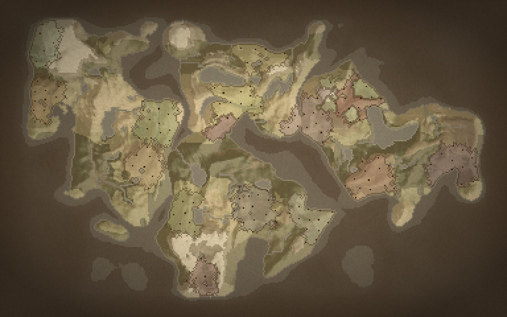 | 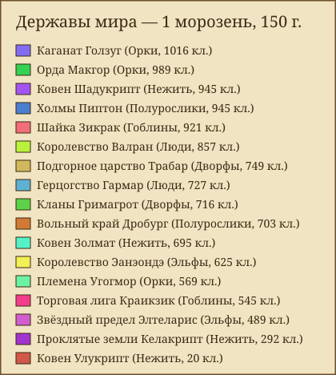 |

## Генерация карты

1. **Высота**: «пятна» континентов (центры разнесены методом лучшего кандидата,
   форма искажена domain warp) + FBM-шум + ridged-шум для горных хребтов,
   океан у краёв карты.
2. **Уровень моря** по перцентилю — доля суши точно равна настройке. Высоты
   нормируются по рангу, поэтому пороги холмов и гор не зависят от seed.
3. **Вода**: связные водоёмы у края — океан, мелководье у берега — море,
   небольшие замкнутые — озёра.
4. **Климат**: температура по широте с поправкой на высоту; влажность — шум,
   близость океана и климатические пояса (влажный экватор, сухие субтропики).
5. **Реки**: Priority-Flood (заполнение впадин) → дерево стока → накопление
   стока; глубокие впадины становятся озёрами, реки увлажняют окрестности.
6. **Биомы**: океан, море, озеро, равнины, степь, лес, джунгли, болото,
   пустыня, тундра, снега, холмы, горы.

Скорость генерации (GDScript): ~0.25 с для 256×160, ~0.6 с для 384×240,
~2.3 с для 768×480; интерфейс при этом не зависает.

## Сборка и CI

* **CI** — `.github/workflows/tests.yml`: на каждый push и PR скачивает
  Godot 4.7.2 (кэшируется), импортирует проект, прогоняет все
  `tests/*_test.gd` (тест падает и при `SCRIPT ERROR` в логе), дым-прогон
  `all_systems_smoke.gd` на 300 лет и выкладывает логи артефактом. Отдельная
  задача профилирует огромную карту (`profile_systems.gd -- 150 3 40 5 8.0`)
  и падает, если средний месяц дольше бюджета (8 мс с запасом на медленные
  раннеры; локально — ~2 мс).
* **Экспорт** — `export_presets.cfg`: Windows, Linux, Web. Нужны шаблоны
  экспорта Godot 4.7.2 (редактор → «Управление шаблонами экспорта»), затем
  `godot --headless --export-release "Linux" build/linux/FantasyMapSimulator.x86_64`
  (или "Windows Desktop", "Web"). Ограничения Web: проект использует рендер
  Forward+ — для Web переключите рендер на Compatibility; создание мира и
  музыка идут в фоновых потоках, поэтому нужен экспорт с поддержкой потоков
  и сервер с заголовками COOP/COEP (SharedArrayBuffer); `user://` в браузере —
  IndexedDB.

## Сохранения

`SaveSystem` пишет мир в `user://saves/<имя>.json` (≈3–4 МБ для карты
384×240, запись ~0.1 с, чтение ~0.4 с в фоне). Большие массивы клеток
(высоты, климат, биомы, владельцы, народы, регионы) хранятся как base64
байтов Packed-массивов; государства, города, герои, войны, ориентиры,
Судьба, летопись и история — обычным JSON. Производный учёт (клетки
государств, длины границ, счётчики регионов) пересобирается через
`World.set_owner` в сохранённом порядке, порядок ключей словарей и состояние
ГСЧ тоже восстанавливаются — загруженный мир продолжает историю ровно так же,
как продолжил бы исходный (проверяет `save_test`).

## Тесты

```bash
# Инварианты генератора, статистика биомов, детерминированность seed:
godot --headless --path . -s res://tests/generation_test.gd -- /tmp/out   # out-папка необязательна (PNG карт)

# Данные рас, имена, стартовые государства, согласованность владельцев клеток:
godot --headless --path . -s res://tests/world_test.gd

# Прогон симуляции: инварианты учёта, рост, города, постройки, скорость тика:
godot --headless --path . -s res://tests/simulation_test.gd -- [годы] [seed] [размер 0..3] [государств]

# Инструменты панели Бога не ломают учёт мира:
godot --headless --path . -s res://tests/god_tools_test.gd

# Герои, великие деяния, источники, портал, Судьба и пустые троны:
godot --headless --path . -s res://tests/heroes_test.gd

# Сохранение → загрузка: совпадение учёта и одинаковое продолжение истории:
godot --headless --path . -s res://tests/save_test.gd -- [seed]

# Религии: доли вер, ереси, новые веры, мнения единоверцев, детерминизм, долгий прогон:
godot --headless --path . -s res://tests/religion_test.gd -- [годы]

# Технологии и культура: данные без циклов, расовые запреты, ассимиляция и учёт ёмкости, Бог:
godot --headless --path . -s res://tests/tech_culture_test.gd -- [годы]

# Разведка, тайные общества и перевороты, организации (запрет войн, общая оборона), наследие:
godot --headless --path . -s res://tests/intrigue_test.gd -- [годы]

# Этап 9: дороги (граф, блокада, рельеф) и далее — климат, подземелье, руины, кризисы:
godot --headless --path . -s res://tests/geo_test.gd -- [годы]

# Этап 10.1: артефакты (переходы, наследство, трофеи, сокровищница), роды, ордена, боги, сохранения:
godot --headless --path . -s res://tests/lore_test.gd -- 300
# Сыграй за героя: старт → путь → событие → встреча → команды → гибель → наследник → наблюдатель:
godot --headless --path . -s res://tests/player_test.gd
# Хроники: истории всех видов без пустых подстановок, стабильность, фильтры, значимость, закладки, экспорт:
godot --headless --path . -s res://tests/chronicles_test.gd -- 250
# Достижения: данные, срабатывание по событиям мира и интерфейса, прогресс, профиль на диске:
godot --headless --path . -s res://tests/achievements_test.gd
# Звук: синтез тем и звуков, лейтмотивы рас, контекст музыки, headless без звука, настройки:
godot --headless --path . -s res://tests/audio_test.gd
# Все системы вместе: 500 лет на 3 seed и 3 размерах карты, без вырождения, сохранение→загрузка:
godot --headless --path . -s res://tests/all_systems_smoke.gd -- [годы] [размеры через запятую] [seed через запятую]

# Время каждой системы симуляции по отдельности (среднее и худший вызов):
godot --headless --path . -s res://tests/profile_systems.gd -- [годы] [размер] [государств] [seed]

# Плавность: настройки, независимость мира от настроек и FPS, камера, растянутые бедствия:
godot --headless --path . -s res://tests/smoothness_test.gd
# Армии: инварианты, фронт, сохранение в походе, инструменты Бога, производительность:
godot --headless --path . -s res://tests/army_test.gd
# Дикий мир: данные, племена и орды, логова, поветрия и чума, иммунитет, наречия, Бог, сохранение, скорость:
godot --headless --path . -s res://tests/wild_test.gd
# Рынок: данные, учёт «произведено = потреблено + запасы + потери», цены, караваны, грабёж, инфляция, займы, наёмники, рабство, сохранение:
godot --headless --path . -s res://tests/economy_test.gd
# Дипломатия и ИИ: нравы, сделки (честное исполнение), журнал, столицы, слухи и разведка, сохранение:
godot --headless --path . -s res://tests/diplomacy_ai_test.gd
# Интерфейс без экрана: главная сцена, режимы карты, окна и карточки разбираются и открываются:
godot --headless --path . -s res://tests/ui_smoke_test.gd
# Герой в живом мире: задания новых видов, товары, караван, войско, плен, болезнь, язык, цепочки, сохранения:
godot --headless --path . -s res://tests/player_world_test.gd
# Удобство: перевод (битые ключи), справочник не устарел, снимки и ветви, экспорт карты, уведомления:
godot --headless --path . -s res://tests/usability_test.gd
# Пересобрать справочник docs/REFERENCE.md из данных:
godot --headless --path . -s res://tests/gen_reference.gd
# Хэш мира: один seed → одна история (и сверка рефакторинга с ожидаемым хэшем):
godot --headless --path . -s res://tests/world_hash_test.gd -- 80 4242 0 [ожидаемый_хэш]
# Скриншоты всех режимов карты (нужен рендер, например Xvfb):
xvfb-run godot --path . --rendering-driver opengl3 -s res://tests/screenshot_tool.gd -- /tmp/out [seed] [государств] [лет]
```
